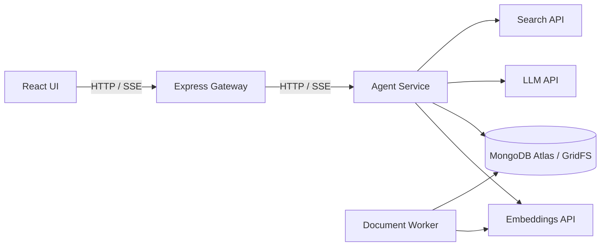

# LUMINA — AI Research Assistant

An AI research assistant that combines live web search, document retrieval, and persistent memory to produce streamed answers with traceable citations.

LUMINA supports a focused **Quick** mode for concise answers and a **Deep Research** mode that plans sub-questions, researches each one, and merges the findings into a single cited response.

## Features

| Feature | Description |
| --- | --- |
| Quick answers | Search the web, attempt page extraction, and stream a concise answer with citations. |
| Deep research | Plan 3–6 sub-questions, retrieve sources for each, and synthesize a structured answer. |
| Conversation history | Persist threads and messages for contextual follow-up questions. |
| Persistent memory | Explicitly save, semantically recall, list, and delete facts and preferences. |
| Document RAG | Upload PDF or text files into Spaces and retrieve indexed passages with locators. |
| Hybrid retrieval | Combine vector and lexical retrieval using reciprocal-rank fusion. |
| Search caching | Reuse results through an in-process cache and MongoDB TTL storage. |
| Observability | Record tool traces, request IDs, latency, token usage, and estimated model cost. |

## Architecture



- **Gateway:** request validation, rate limits, request IDs, and streaming relay.
- **Agent:** research tools, citation synthesis, memory, retrieval, and run logging.
- **Worker:** durable document jobs, parsing, chunking, embeddings, and indexing verification.
- **Atlas:** conversations, memories, documents, vectors, cache, jobs, and run records.

Provider credentials remain in the Agent and Worker environment.

## Technology

TypeScript · Node.js · Express · React · Vite · MongoDB Atlas · GridFS · Atlas Vector Search · Anthropic · OpenAI Embeddings · Tavily / SerpApi · Vercel · Fly.io

## Local setup

### Requirements

- Node.js **20.19 or newer** and npm.
- MongoDB Atlas with database credentials, network access, and the required search indexes.
- Credentials for the configured LLM, search, and embedding providers.

### Install and configure

```bash
npm ci
cp .env.example .env
```

Fill in the database connection and provider keys in `.env`. The example contains placeholders only; never commit real credentials.

```bash
npm run indexes
npm run dev
```

The index command writes index configuration to your configured database. The development command starts the Agent, Gateway, and UI. Open the local URL printed by Vite, normally `http://localhost:5173`.

Start document processing in a second terminal from the project root:

```bash
npm run worker
```

**Usage costs:** model requests, embeddings, searches, and hosted services may consume credits or incur charges. Document processing sends extracted text to the embedding provider. Installation alone does not verify provider connectivity or application performance.

## Configuration

| Variable | Purpose |
| --- | --- |
| `MONGODB_URI`, `MONGODB_DB` | Database connection and application database. |
| `VECTOR_BACKEND` | Atlas Vector Search or the local cosine-scan fallback. |
| `LLM_PROVIDER`, `LLM_MODEL` | Configured provider and Deep synthesis model. |
| `QUICK_LLM_MODEL`, `PLANNER_LLM_MODEL` | Quick synthesis and research planning models. |
| `SEARCH_PROVIDER` | `tavily` or `serpapi`; supply the corresponding key. |
| `OPENAI_API_KEY`, `EMBEDDING_MODEL` | Document and memory embeddings. |
| `DEEP_DAILY_CAP` | Per-user daily Deep request limit. |
| `VITE_API_URL`, `AGENT_URL` | Browser-to-Gateway and Gateway-to-Agent wiring. |

See [.env.example](.env.example) for the configuration template and [DESIGN.md](DESIGN.md) for implementation decisions.

## Evaluation and current status

The latest complete deployed benchmark recorded in the design notes is from **October 8, 2026**. These are historical measurements, not a guarantee of current availability or performance.

| Metric | Recorded result | Target / interpretation |
| --- | --- | --- |
| Quick first-token p95 | 2,849 ms | Above the 2,500 ms target. |
| Quick complete-answer p95 | 6,262 ms | Within the 12,000 ms target. |
| Upload acceptance p95 | 3,155 ms | Above the 300 ms target. |
| Deep plan p95 | 2,518 ms | Within the 4,000 ms target. |
| Deep complete-answer p95 | 47.9 seconds | Within the 90-second target. |
| Recall@5 | 0.90 | Above the 0.70 target. |
| Verified citation grounding | 140 / 140 | 11 blocked or unverifiable citations were excluded. |

All 90 requests in that benchmark completed; the web-search workload was fully cached. Later small diagnostics are documented separately and do not replace the full benchmark. The latest thread/history concurrency change has not been deployed or measured in a new full benchmark.

Known limitations include variable uncached search latency, intermittent upload ingress delay, extraction failures on some pages, and unfinished demo-video and human-review evidence. Generated reports and raw run logs are excluded from Git; a fresh evaluation requires new evidence.

The evaluation commands can make paid provider requests:

```bash
npm run bench -- --target https://YOUR_GATEWAY_HOST
npm run quality
npm run eval
```

See [TECHNICAL.md](TECHNICAL.md) and [DESIGN.md](DESIGN.md) for evaluation procedures and reflections. Deployments may be stopped between sessions to limit costs.

## Repository structure

```text
backend/agent/       Research service and document worker
backend/gateway/     Public API and SSE relay
web/                 React application
packages/contract/   Shared API, event, and database schemas
benchmark/           Latency and workload benchmark
quality/             Run-trace checks
eval/               Evaluation builder and retrieval corpus
scripts/             Index configuration and run export
docs/               Original assignment and source attribution
DESIGN.md            Architecture, trade-offs, and measured results
```

## Project contributions and origin

This repository presents Michele Chen's LUMINA implementation from the team repository. The backend implementation includes Quick and Deep research, streaming and cancellation handling, persistent memory, asynchronous document processing, retrieval, caching, and deployment/performance diagnostics.

The React UI, shared contract, assignment specification, and evaluation tooling originated from the course starter. Original requirements and tools are retained so the implementation can be understood and evaluated against its source specification.

See [source attribution](docs/PROVENANCE.md) and [original assignment README](docs/course-assignment.md).
